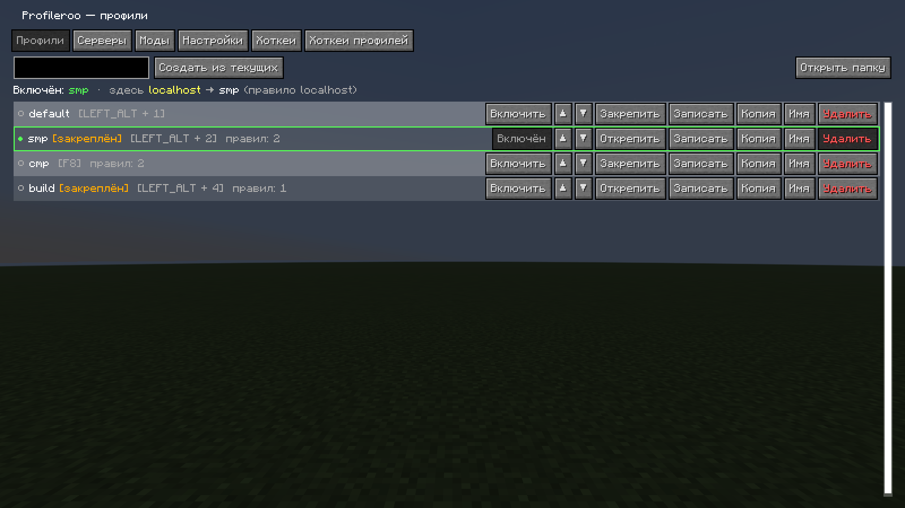
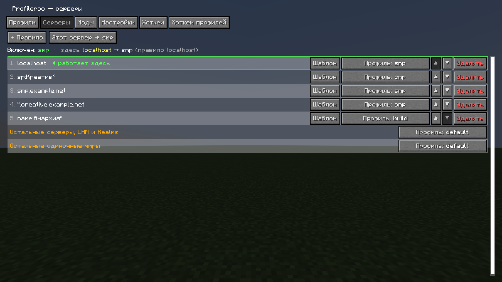
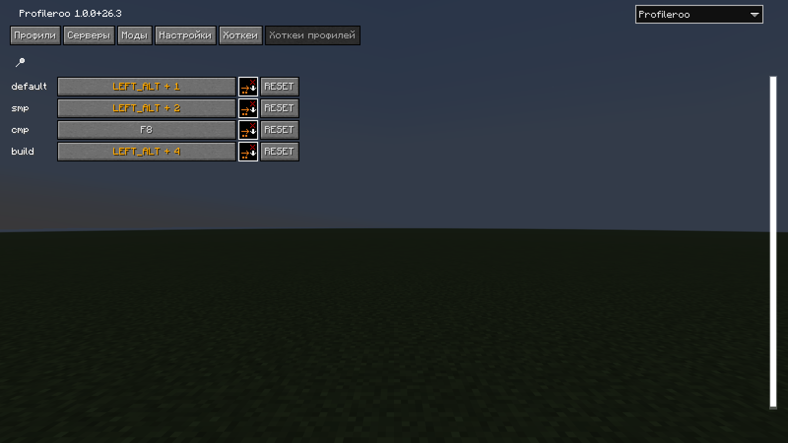
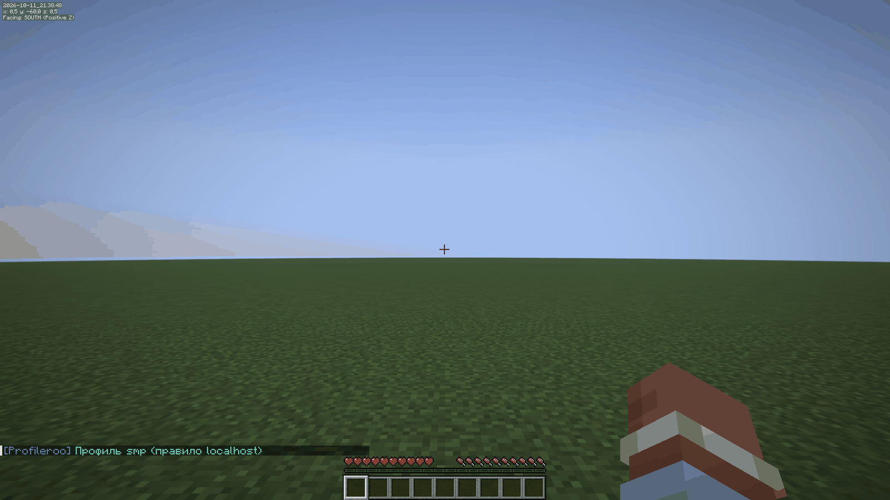
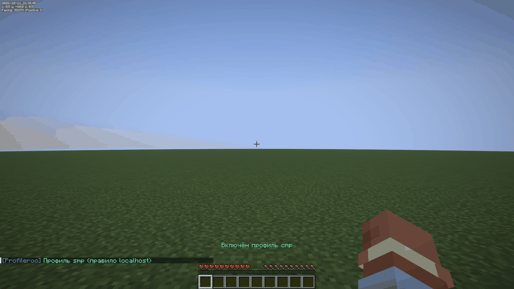
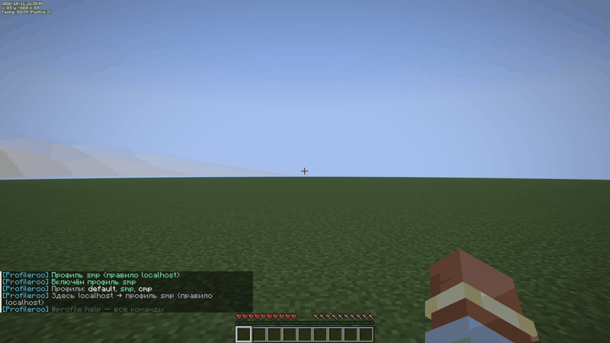
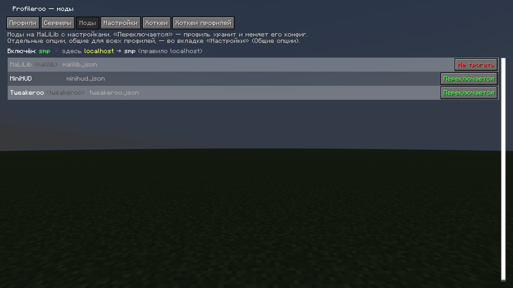
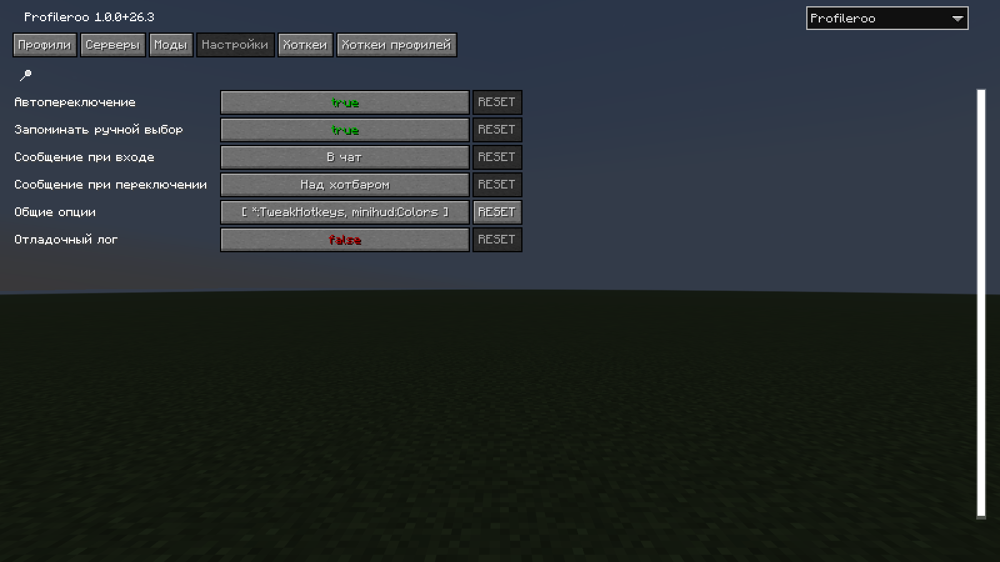
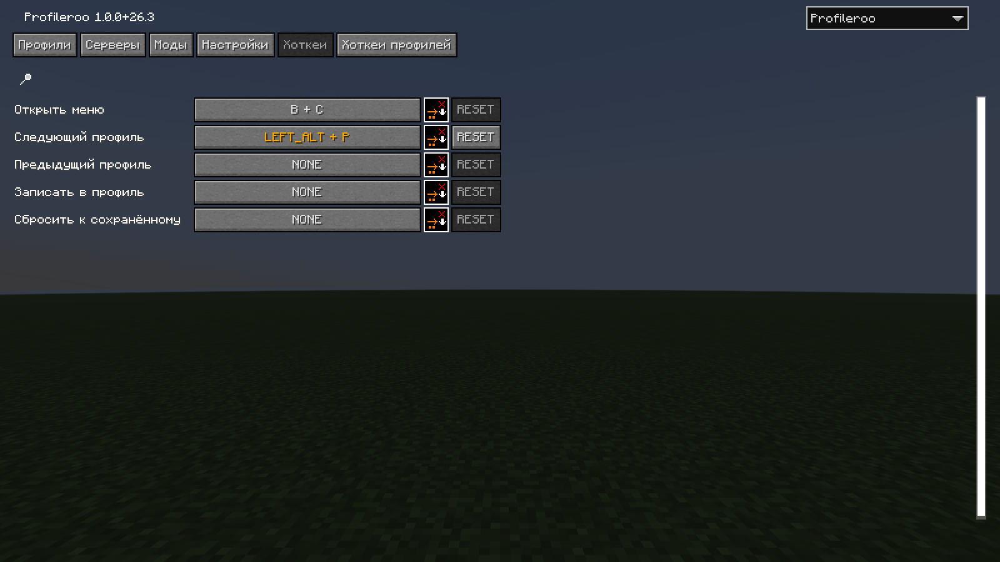

# Profileroo

Профили биндов и настроек для **Tweakeroo, MiniHUD, Litematica, Item Scroller** и любых других модов на MaLiLib.
На СМП — одни бинды и включённые твики, на ЦМП — другие, в одиночке — третьи. Профиль включается сам при входе
на сервер.

Minecraft **26.3**, Fabric, нужен **MaLiLib 0.30.x**. Fabric API не нужен.



## Как пользоваться

1. Открой меню: **B + C** (или `#profile gui` в чате, или Mod Menu).
2. При первом запуске всё, что сейчас настроено в модах, становится профилем **default**
   (а копия конфигов кладётся в `config/profileroo/backups`).
3. Вкладка **«Профили»**: впиши имя и нажми **«Создать из текущих»** — например `smp` и `cmp`.
4. Вкладка **«Серверы»**: добавь правила — `smp.example.com → smp`, `*.creative.net → cmp`.
5. Заходи на сервер: Profileroo сам включит нужный профиль ещё до того, как моды загрузят настройки.
   Дальше просто настраивай Tweakeroo/MiniHUD как обычно — изменения сохраняются в профиль этого сервера.



## Что умеет

| | |
|---|---|
| **Автопереключение** | При входе профиль выбирается по правилам сверху вниз. Если правила нет — профиль «для остальных серверов» / «для одиночных миров» (или «не переключать»). |
| **Правила** | `play.example.com` (любой порт), `play.example.com:25566`, маски `*.example.com`, `192.168.1.*`, `name:SMP*` — по имени в списке серверов, `sp` / `sp:Креатив*` — одиночные миры, `lan`, `realms`, `realms:<имя>`. |
| **Запоминание выбора** | Включил профиль вручную на сервере без правила — правило добавится само. Сервер с явным правилом не перезаписывается. |
| **Закреплённые профили** | Изменения в игре не сохраняются в закреплённый профиль: каждый вход начинается с сохранённых настроек — «по дефолту что-то включено». Обновить — кнопкой «Записать». Переход между серверами за прокси (Velocity) не сбрасывает. |
| **Общие опции** | Опции, одинаковые во всех профилях. `*:TweakHotkeys` — одни бинды везде, а тумблеры разные; `tweakeroo:Generic.*` — общая вкладка Generic; `!` исключает. |
| **Моды** | Каждый мод на MaLiLib можно исключить: его настройки профили не трогают. MaLiLib сам по умолчанию исключён. |
| **Хоткеи** | Свой хоткей на каждый профиль, «следующий / предыдущий», «записать в профиль», «сбросить к сохранённому». |
| **Команды** | `#profile` в чате (на сервер не уходит). |
| **Безопасность** | Запись через временные файлы; если игра упала посреди переключения — оно докончится при следующем запуске. Удалённые профили лежат в `config/profileroo/trash`. Симлинки на конфиги не ломаются. |



## Команды

```
#profile                      профили и что включится здесь
#profile <имя>                включить профиль
#profile next | prev          следующий / предыдущий
#profile save [имя]           записать текущие настройки в профиль
#profile reset                отменить несохранённые изменения
#profile create <имя>         новый профиль из текущих настроек
#profile copy <из> <в>
#profile rename <старое> <новое>
#profile delete <имя>
#profile lock [имя] | unlock [имя]
#profile bind [имя]           привязать этот сервер к профилю
#profile unbind               убрать привязку этого сервера
#profile gui                  открыть меню
```

## Как это устроено

MaLiLib сохраняет конфиги всех модов при выходе из мира и заново читает их при входе. Profileroo встаёт
прямо перед этим чтением: сохраняет текущие файлы конфигов в папку включённого профиля и кладёт на их место
файлы нужного профиля — моды загружают их сами. При ручном переключении в игре моды перечитывают конфиги сразу.

Какие файлы у какого мода, Profileroo узнаёт, наблюдая за сохранением через MaLiLib, поэтому работают
и моды, о которых он ничего не знает.

```
config/profileroo/
  state.json                       профили, правила, хоткеи профилей
  profiles/smp/tweakeroo/tweakeroo.json
  profiles/smp/minihud/minihud.json
  backups/  trash/
```

Папку профиля можно скопировать в другую сборку — Profileroo подхватит её как профиль.

## Скриншоты

| | |
|---|---|
|  |  |
|  |  |
|  |  |
